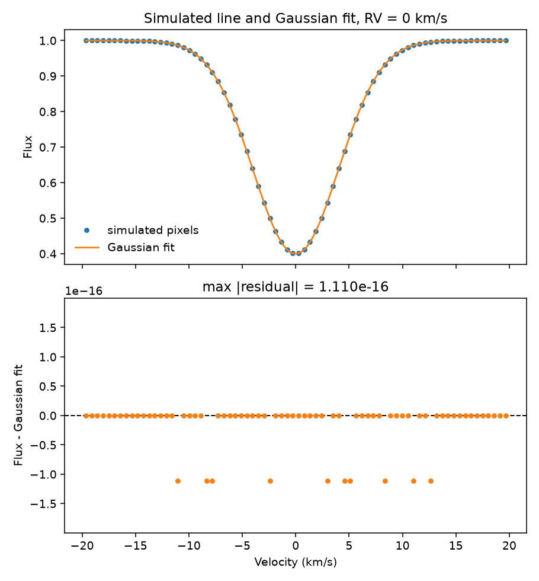
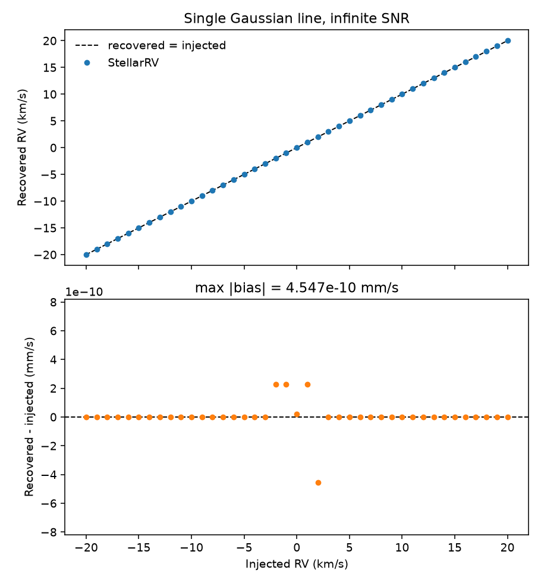

# Single Gaussian line

Idealized injection of one absorption line on a single order, at infinite
signal to noise. `StellarRVPrimitive` recovers that line at every injected RV.

## Setup

Order 136 is a 4096-pixel linear wavelength grid centered at 1.080882 um.
The pixel scale is 538 m/s in velocity space.

We set up a high signal-to-noise spectrum with continuum flux at 1. We then
add a Gaussian in velocity,

$$F(v)=1-D\exp\left(-\frac{1}{2}\left(\frac{v-v_{\mathrm{inj}}}{\sigma_v}\right)^{2}\right),$$

with $D=0.6$ and $`\sigma_v=4`$ km/s, and $`v=c(\lambda/\lambda_0-1)`$.

Per-pixel flux error is $10^{-8}$ (continuum SNR $10^{8}$ per pixel). The floor
keeps the CCF weights finite. The centroid is the infinite-SNR limit.

For the StellarRVPrimitive the mask is one delta line at the injected rest
wavelength. The injected spectrum is kept in float64.

## StellarRV arguments

`StellarRVPrimitive` runs `ccf_line_mask` with the search grid centered on the
injected RV. Resampling onto that grid is turned off, and the Gaussian fit
leaves the continuum free.

| Argument | Value |
|----------|------:|
| `mask_ccf_resample` | false |
| `mask_ccf_fit_baseline_free` | true |
| `v_half_window` | 20000 m/s |
| `window_line_by_line` | true |
| spectral window | +/- 20 line widths |
| `ccf_input_velocity` | injected RV |

With resampling off, one delta line is read at the pixel velocities
$`v=c((\lambda/\lambda_0)(1+z_b)-1)`$.

## Recovery

Injected RV runs from -20 km/s to 20 km/s in steps of 1 km/s (41 trials).

| Quantity | Value |
|----------|------:|
| Max absolute bias | $4.5\times 10^{-10}$ mm/s |
| RMS bias | $9.4\times 10^{-11}$ mm/s |
| Max formal RV uncertainty | $5.4\times 10^{-4}$ mm/s |

## Line profile

Simulated pixels at RV = 0 and the free-continuum Gaussian fit on those pixels.
The largest flux residual is $1.1\times 10^{-16}$.

## Recovered RV

Recovered RV versus injected RV. The top panel sits on the one-to-one line.
Residuals away from zero in the lower panel are one last place of the fitted
mean, and they fall within a few km/s of zero. The largest residual on this
grid is $4.5\times 10^{-10}$ mm/s.

## Code

| Piece | Location in `HISPEC_DRP` |
|-------|--------------------------|
| Injection and recovery | `hispecdrp/simulations/gaussian_line_rv.py` |
| Unit test | `tests/simulations/test_gaussian_line_rv.py` |
