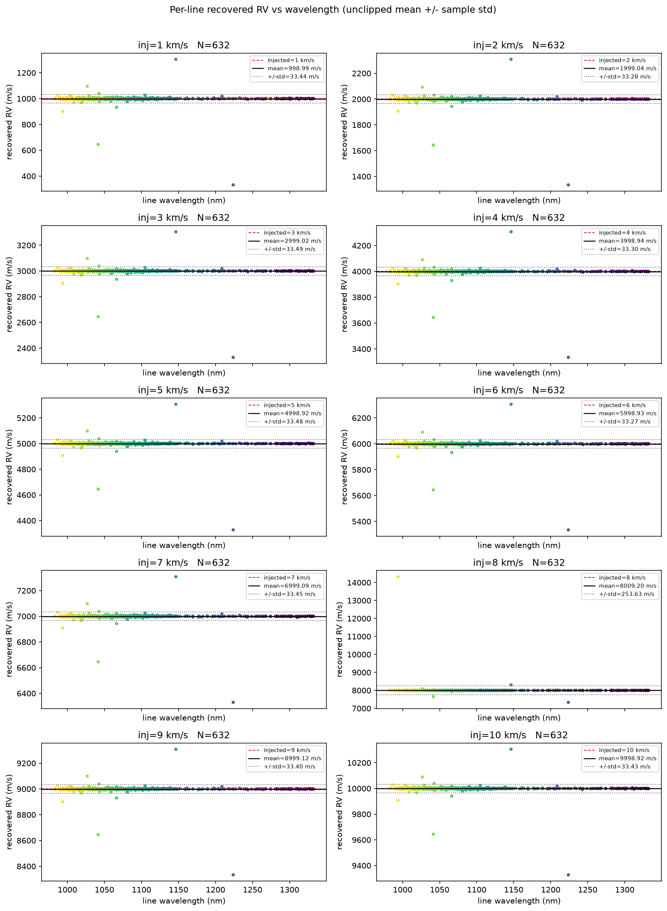
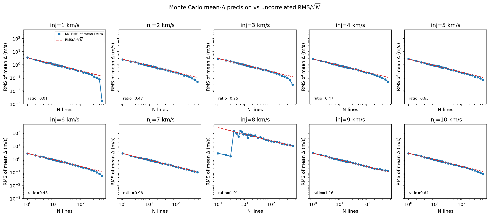
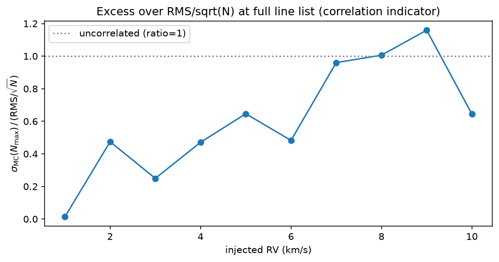
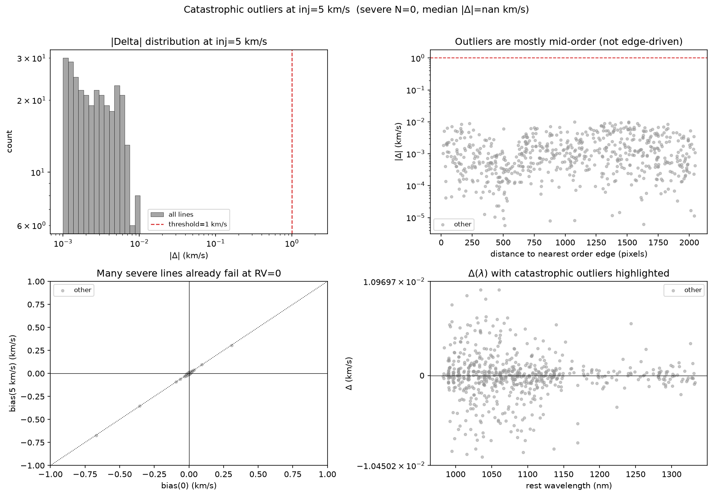
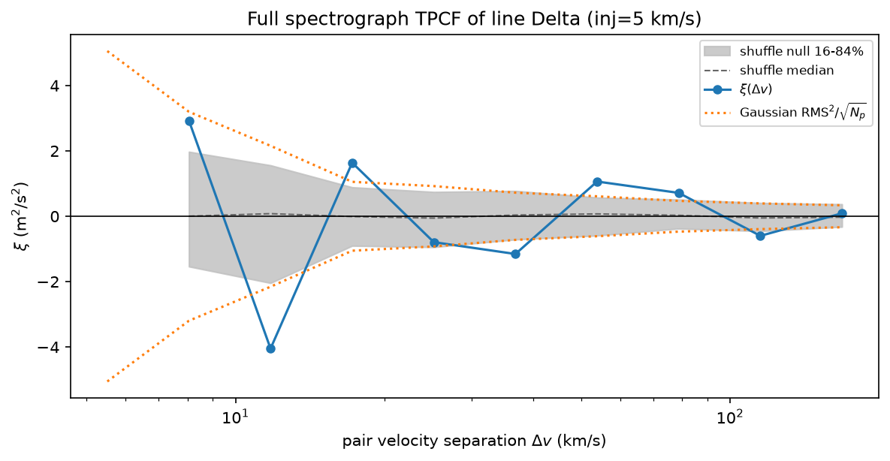

# Multi-line centroid CCF (Δ quality cut)

## How it was run (`HISPEC_DRP`)

- Notebook: `examples/notebooks/multi_line_centroid_ccf.ipynb`
- Ideal L2 paint via `build_l2` (BSPEC, lte040, `n_fine=512`)
- Line-by-line `StellarRVPrimitive` (`ccf_line_mask`), inject grid \(0\)–\(10\) km/s @ 1 km/s
- Per-line \(\Delta_i(v)=\mathrm{bias}_i(v)-\mathrm{bias}_i(0)\); quality mask keeps lines with
  \(\max|\Delta|\le 10\) m/s and \(|\mathrm{RV}-v|\le 1\) km/s over the grid

Machine-readable summary:
[`assets/tables/delta_cut10_summary.json`](../assets/tables/delta_cut10_summary.json).

## Headline numbers (Δ ≤ 10 m/s product)

| Quantity | Value |
|----------|------:|
| Mask lines on disk | 549 |
| Common lines on re-run (multi-order chunks) | 632 |
| Lines passing Δ≤10 on all injects | 631 |
| Δ RMS | **2.85 m/s** |
| Cut mode | `all_inj_iter3` |
| Abs RV gate | 1000 m/s |

## Plots

### Recovered RV vs wavelength

### Monte Carlo precision vs number of lines

Theory \(\mathrm{RMS}/\sqrt{N}\) vs subset Monte Carlo on the common-line sample.

### Correlation excess vs inject

Ratio of MC scatter to \(\mathrm{RMS}/\sqrt{N}\) (≈1 ⇒ independent averaging).

### Catastrophic / high-bias outliers

### TPCF (full spectrograph)

## Notes

Absolute-RV plots can look extreme when a few lines have large stable
\(\mathrm{bias}(0)\) (peak locked away from the prior). Differential \(\Delta\) removes
that zero-point; the Δ≤10 cut is the notebook quality product used as a parent for
later iterative rezero experiments.
