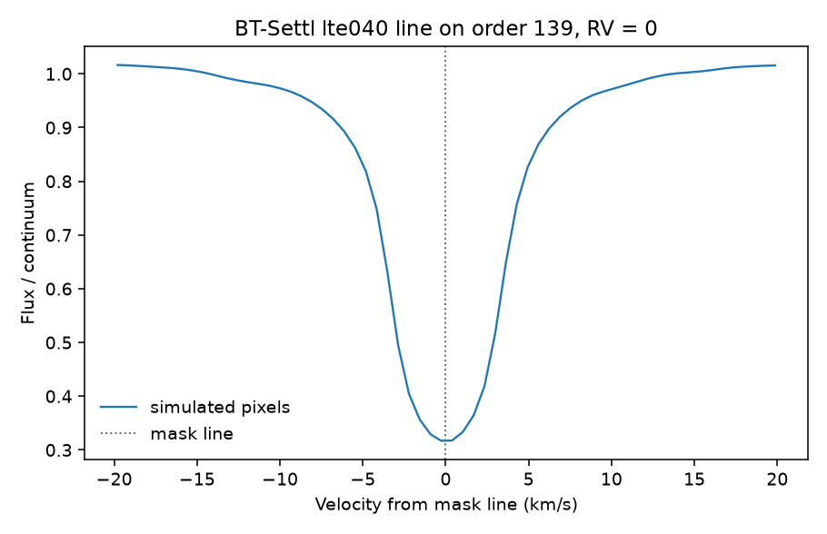
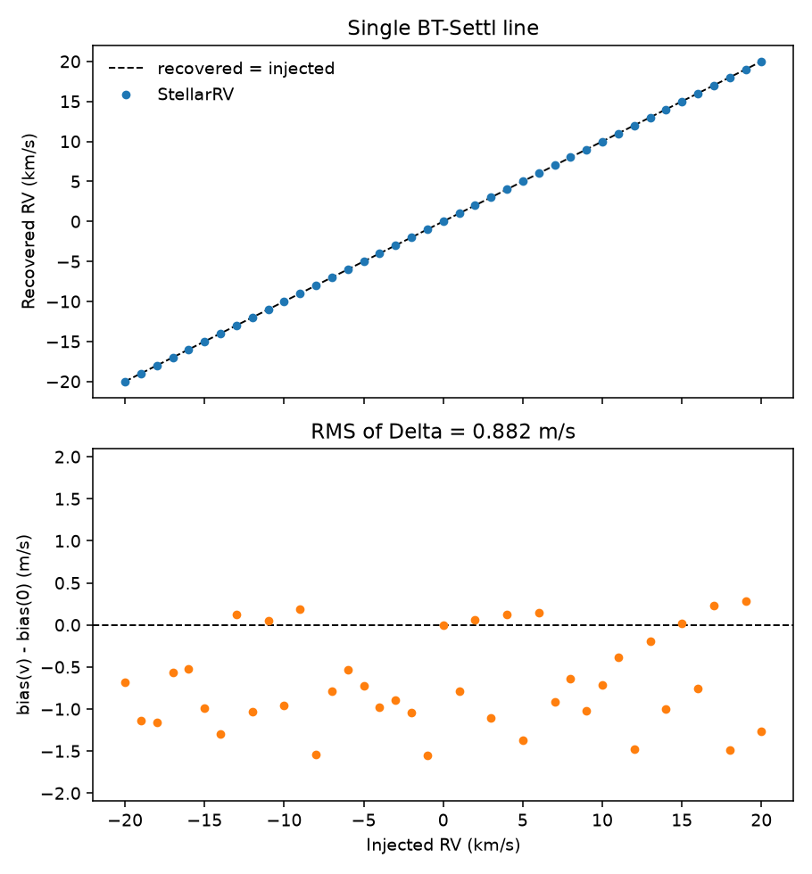

# Single template line

One absorption line from the BT-Settl lte040 template, painted onto a single
order. `StellarRVPrimitive` recovers that line on the same velocity grid as
the single-Gaussian example.

## Setup

The template is BT-Settl `lte040.0-4.5-0.0a+0.0.BT-Settl.spec.7` (4000 K).
Order 139 is the BSPEC detector grid, 4096 pixels. The line is a ccfopt
entry at 1.049898 um. It is about 70 percent deep, and the next mask line is
61 km/s away. The line is more than 1000 km/s from either edge of the order,
so the full inject grid stays on the detector.

The spectrum is the template, Doppler-shifted and painted with `n_fine=512`,
then placed on the detector wavelengths.

For the StellarRVPrimitive the mask is one delta line at that rest wavelength.

## StellarRV arguments

`StellarRVPrimitive` runs `ccf_line_mask` with the ideal-spectrum line-by-line
settings. The search grid is centered on the injected RV.

| Argument | Value |
|----------|------:|
| `v_step_coarse` | 10 m/s |
| `v_half_window` | 20000 m/s |
| `mask_ccf_pixel_interp_order` | 3 (Lanczos-3) |
| `window_line_by_line` | true |
| `window_size_um` | $5.65\times 10^{-5}$ um |
| `n_fine` | 512 |
| `ccf_input_velocity` | injected RV |

The wavelength window is about +/- 8.1 km/s around the line.

## Recovery

Injected RV runs from -20 km/s to +20 km/s in steps of 1 km/s (41 trials).

Delta is the bias at that RV minus the bias at 0 km/s. The bias at 0 km/s is
+0.57 m/s.

| Quantity | Value |
|----------|------:|
| RMS of Delta | 0.88 m/s |
| Max absolute Delta | 1.55 m/s |
| Max absolute bias | 0.98 m/s |

## Line profile

The painted line at RV = 0. Flux is divided by the local continuum. The
dotted line is the mask wavelength.

## Recovered RV

Recovered RV versus injected RV, and Delta in m/s. Every trial stays on the
one-to-one line. The RMS of Delta is 0.88 m/s.

## Code

| Piece | Location in `HISPEC_DRP` |
|-------|--------------------------|
| Injection and recovery | `hispecdrp/simulations/template_line_rv.py` |
