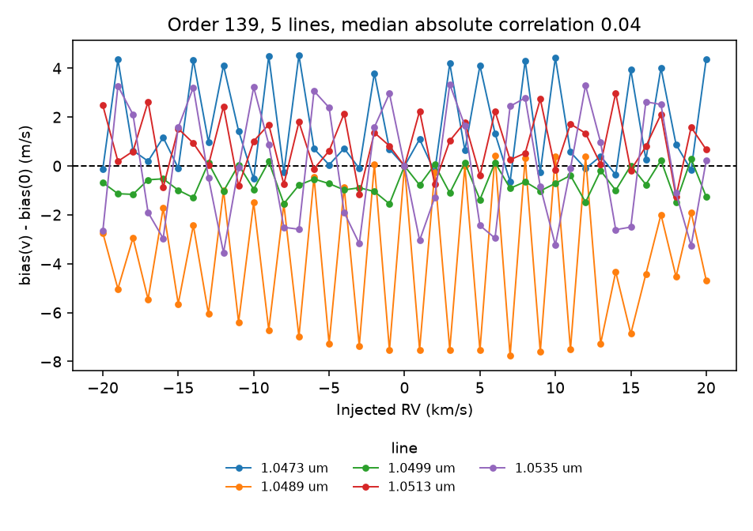

# Several lines on one order

Five absorption lines from the BT-Settl lte040 template, all on order 139.
One mask holds every line. `StellarRVPrimitive` recovers each line on the
same velocity grid as the single-line examples.

A bulk velocity shift puts each line center at a different place within a
pixel. The recovery error that follows that position therefore does not
repeat from line to line.

## Setup

The template, order, and paint are the same as the single template line.
The five lines are ccfopt entries spread across order 139. Each is isolated
from the next mask line by more than 30 km/s, and each stays on the detector
for the full inject grid. The line at 1.049898 um is the line from the
single-template-line page.

For the StellarRVPrimitive the mask is one delta line at each rest
wavelength. The lines are fit separately (`window_line_by_line`).

## StellarRV arguments

The arguments are the same as the single template line. The search grid is
centered on the injected RV.

| Argument | Value |
|----------|------:|
| `v_step_coarse` | 10 m/s |
| `v_half_window` | 20000 m/s |
| `mask_ccf_pixel_interp_order` | 3 (Lanczos-3) |
| `window_line_by_line` | true |
| `window_size_um` | $5.65\times 10^{-5}$ um |
| `n_fine` | 512 |
| `ccf_input_velocity` | injected RV |

## Recovery

Injected RV runs from -20 km/s to +20 km/s in steps of 1 km/s (41 trials).
Delta for each line is its bias at that RV minus its bias at 0 km/s.

The size of Delta differs from line to line. The series do not track each
other. The median absolute pairwise correlation is 0.04, and the largest is
0.17. The line at 1.049898 um has the same RMS as on its own page.

| Line (um) | RMS of Delta (m/s) |
|-----------|-------------------:|
| 1.047252 | 2.45 |
| 1.048907 | 4.91 |
| 1.049898 | 0.88 |
| 1.051289 | 1.46 |
| 1.053511 | 2.41 |

## Delta for each line

## Code

| Piece | Location in `HISPEC_DRP` |
|-------|--------------------------|
| Injection and recovery | `hispecdrp/simulations/template_order_lines_rv.py` |
